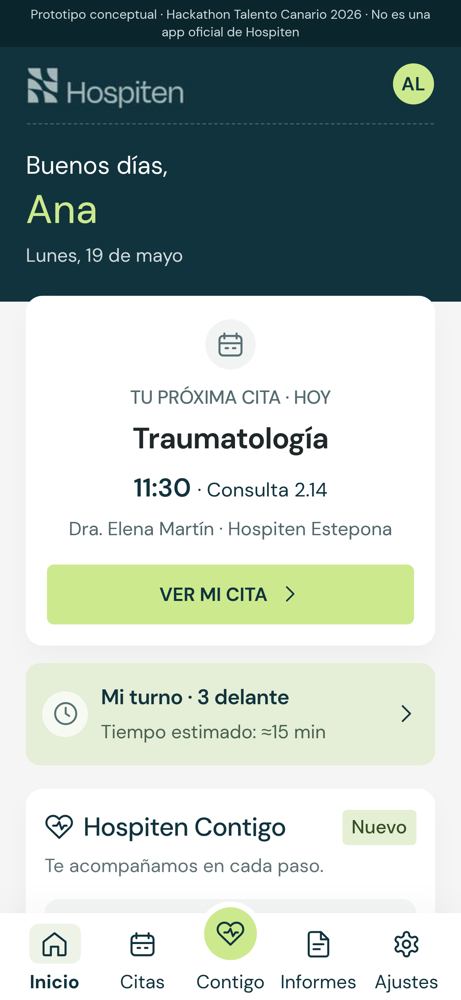
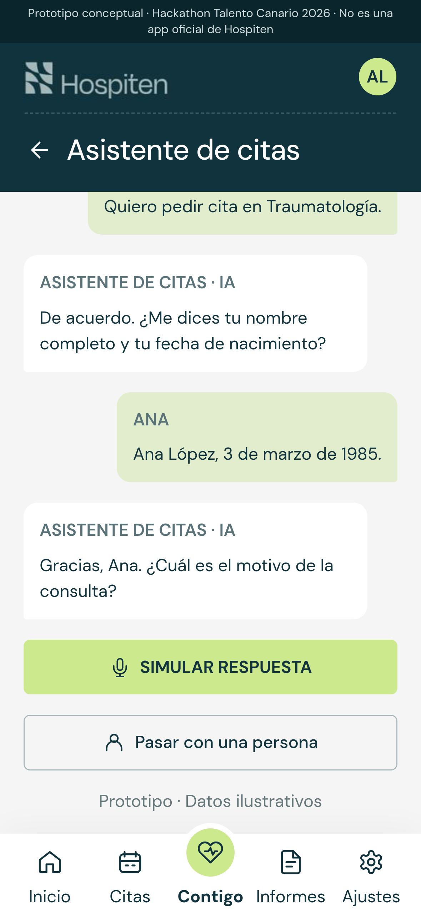
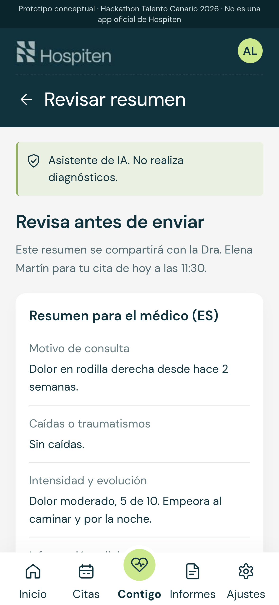
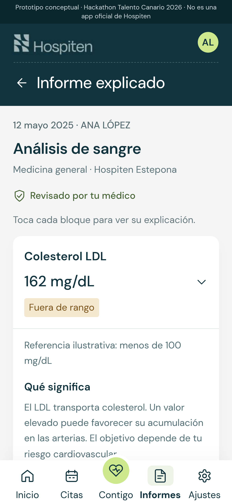

# Hospiten Contigo

> **Prototipo conceptual · Hackathon Talento Canario 2026 · No es una app oficial de Hospiten.**
> Todos los datos, personas y envíos son ficticios o simulados.

Propuesta para el reto de Hospiten: **mejorar la comunicación entre hospital y paciente antes, durante y después de la consulta**. "Hospiten Contigo" sería una sección nueva dentro de la app que Hospiten ya tiene, no una app aparte.

**Pruébalo en el móvil o en el navegador:** https://stefanpuerner.github.io/hospiten-contigo/

<p>
  
  
  
  
</p>

## Qué incluye

El recorrido del paciente, en este orden:

1. **Asistente telefónico de citas.** Llamada simulada para pedir, cambiar o anular cita. No da información clínica y puede pasar con una persona del equipo de citas, que recibe un resumen de lo hablado.
2. **Pre-consulta.** Un chat guiado en el idioma del paciente. El médico recibe el resumen en español.
3. **Turno en vivo.** Cuántas personas hay delante y aviso antes de entrar.
4. **Traducción en consulta.** Subtítulos y traducción entre paciente y médico, con opción de solicitar intérprete.
5. **Informe explicado.** Resultados con una explicación sencilla y la posibilidad de enviar una duda a la consulta.

Además: **Ajustes y privacidad** (persona de confianza con permisos separados, reglas por edad, consentimiento para mejorar la IA desactivado por defecto, información de protección de datos) y **Hablar con una persona** (atención al paciente) en el detalle de la cita y en el turno.

## Idiomas

Español, inglés y alemán. El idioma es un ajuste global (Ajustes → Idioma): cambian toda la app y el asistente. Los textos en inglés y alemán están pendientes de revisión por una persona nativa.

## Decisiones de diseño

- Estilo fiel a la app real de Hospiten, porque el público es Hospiten.
- Lo que queda fuera de la comunicación hospital–paciente (pagos, navegación en el hospital…) puede aparecer como decorado, pero no es navegable.
- Nada promete más de lo que dice la presentación, y cada envío simulado lo indica.

## Desarrollo

React 19 + Vite 8 + Tailwind 4. Requiere Node 22 y pnpm 10 (ver `.mise.toml`).

```sh
pnpm install
pnpm dev        # http://localhost:8443
pnpm build      # genera dist/
pnpm exec tsc --noEmit   # comprobación de tipos (el build no la hace)
```

La navegación es por estado, sin router: recargar la página vuelve a Inicio.

```
src/App.tsx     pantallas y lógica
src/i18n.ts     textos y datos de ejemplo en ES / EN / DE
src/Icon.tsx    iconos SVG
src/index.css   estilos
capturas/       capturas de pantalla tamaño móvil para la presentación
HANDOFF.md      contexto del proyecto, reglas y tareas pendientes
```

## Despliegue

Cada push a `main` publica en GitHub Pages mediante [.github/workflows/deploy.yml](.github/workflows/deploy.yml). El nombre del repositorio debe seguir siendo `hospiten-contigo`, porque `base` en `vite.config.ts` es `/hospiten-contigo/`.

## Aviso

Proyecto de hackathon sin relación oficial con Hospiten. Hospiten y su logotipo pertenecen a sus titulares. El texto de protección de datos es de ejemplo; el definitivo lo fijaría Hospiten.
